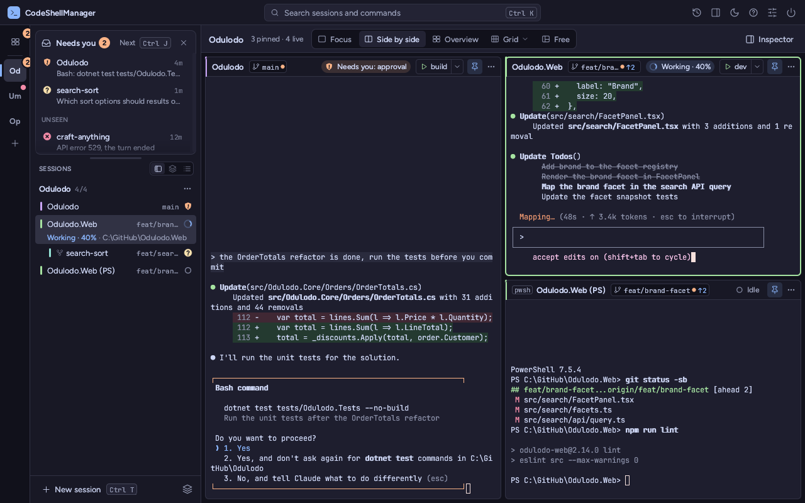
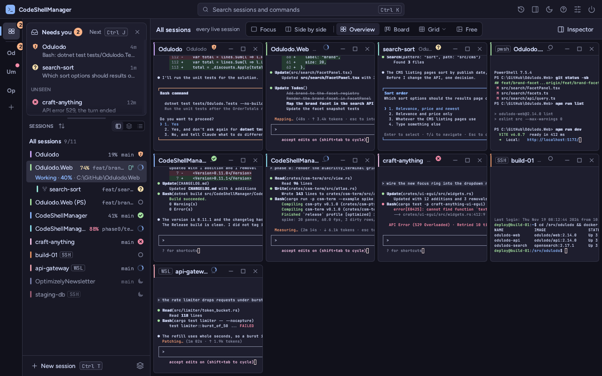
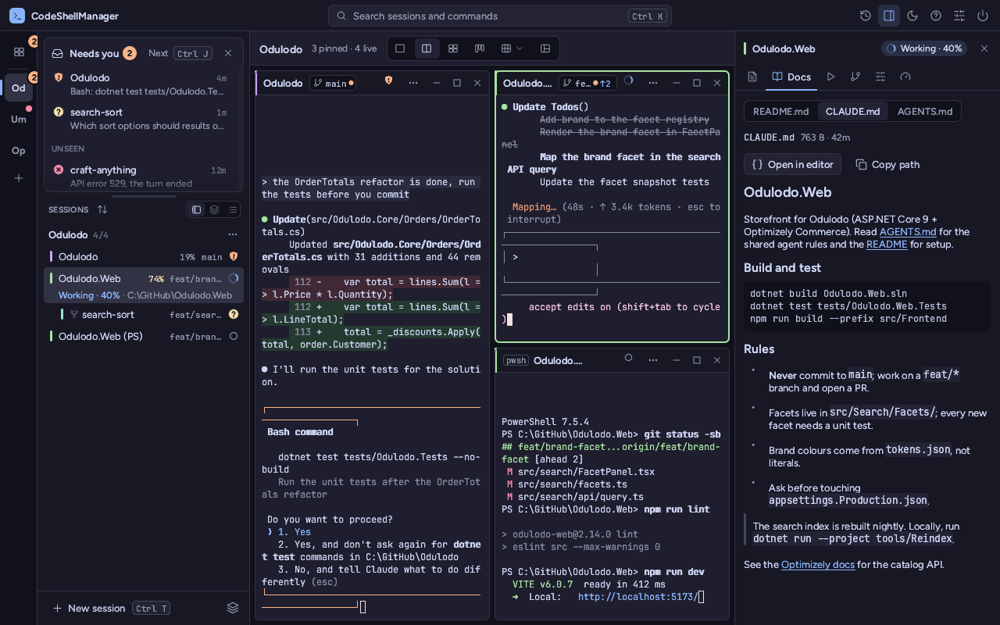
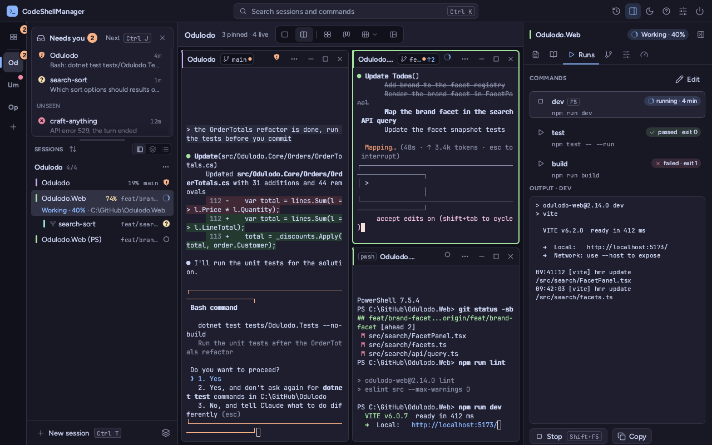
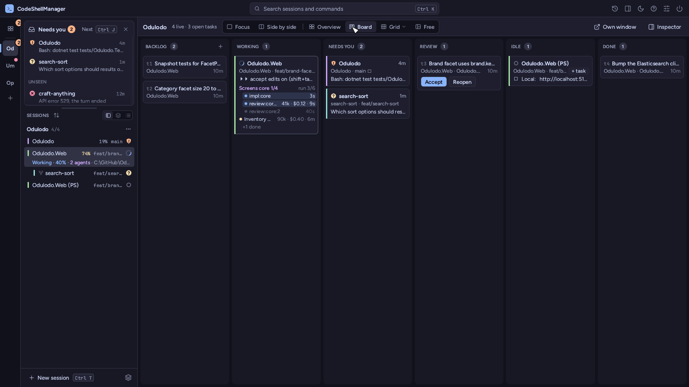
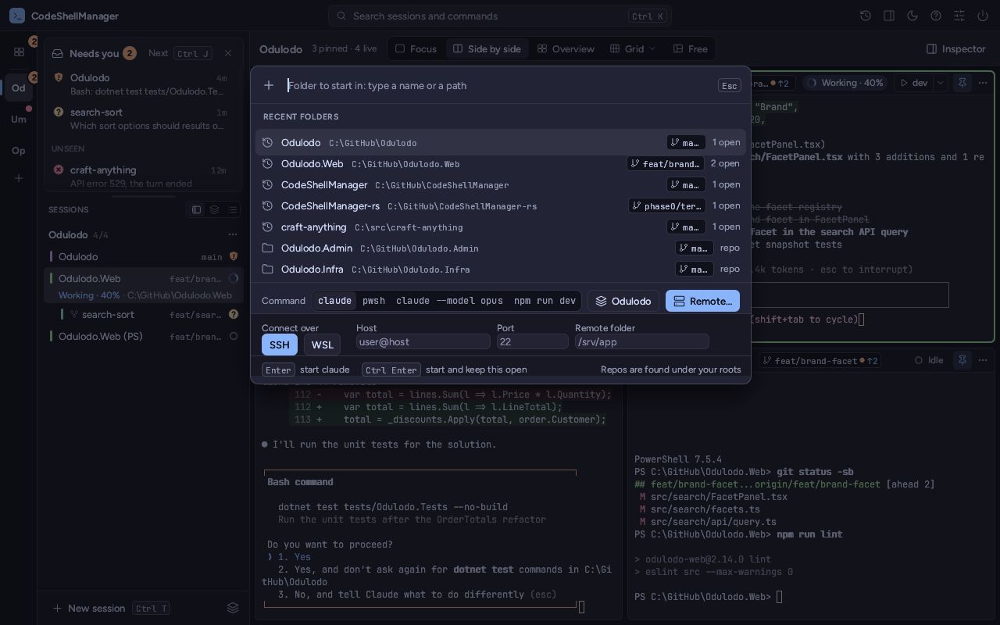
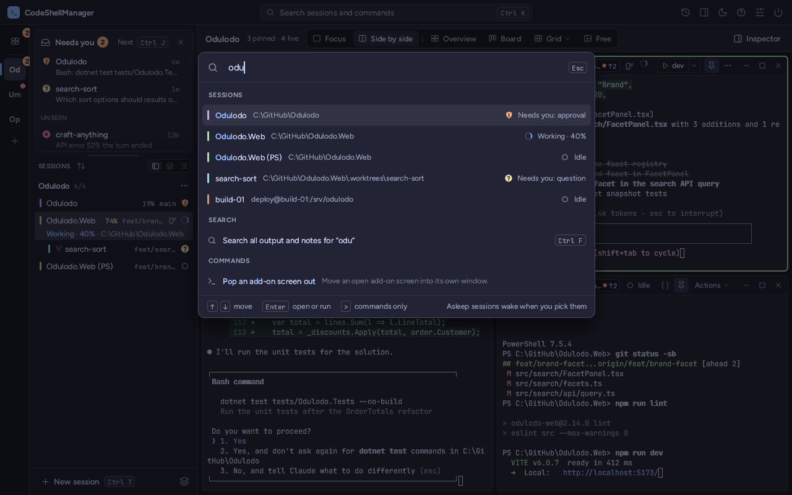

# CodeShellManager

[](https://github.com/umage-ai/CodeShellManager/actions/workflows/ci.yml)
[](https://github.com/umage-ai/CodeShellManager/releases/latest)
[](https://winstall.app/apps/UmageAI.CodeShellManager)
[](https://community.chocolatey.org/packages/codeshellmanager)
[](LICENSE)

> **🌐 [umage.ai/products/code-shell-manager](https://umage.ai/products/code-shell-manager/)**: product page, screenshots and news

A desktop app for running **many AI coding agents side by side**: Claude Code, Codex, Gemini CLI,
GitHub Copilot, or any CLI tool, each in a real terminal, with one place that tells you which of
them needs you.

Native and GPU-rendered (Rust, egui + wgpu, Windows ConPTY). Drive it from its own window, from the
`csm` command line, or let your agents drive it over MCP.



> **Upgrading from 0.x?** CodeShellManager 2.0 is a rewrite of the WPF app (0.11 and earlier).
> See [What's new in 2.0](#whats-new-in-20-upgrading-from-0x) for what changes and how your
> sessions come across.

---

## Why CodeShellManager

Most multi-agent tools are task orchestrators: a chat UI around one vendor's agent, a handful of
parallel tasks, a diff to review. CodeShellManager is built for a different job. It hosts **many
long-lived agent sessions as real terminals**, and helps you keep track of all of them.

- **The real CLI, nothing lost.** Each session is the actual `claude` (or `codex`, `gemini`,
  `copilot`, `pwsh`…) running in a real pseudo-terminal, through your own PowerShell profile.
  Hooks, plugins, slash commands, status lines and profile functions work as they do in Windows
  Terminal.
- **One answer to "who needs me?"** Every session has one status (Working, Needs you, Done,
  Idle, Asleep, Error), shown the same way in the sidebar, the pane header, the palette and the
  tray. The **Needs you** inbox lists the sessions waiting for an answer, oldest first; `Ctrl+J`
  jumps to the next one.
- **Search everything every session ever printed.** All output is indexed to SQLite FTS5. Find the
  session that printed that error, URL or decision, even after it was closed, and reopen it from
  the result.
- **Built for fleets.** Groups with their own layout, sleep and wake to park projects without
  closing them, bulk restart, an Overview of every live session, and a Board that shows what each
  agent and its subagents are doing.
- **Your agents can use it too.** Every action in the app is a tool, so `csm` (the CLI) and
  `csm mcp` (an MCP server) can do anything the UI can. Anything risky waits for your OK on a
  consent card.
- **Local, SSH and WSL** sessions side by side. Install with winget or Chocolatey; no account; MIT.

## How it compares

A condensed view. Competitor columns as of October 2026; tools without a Windows build (Conductor,
Superset, cmux) are left out. See [docs/comparison.md](docs/comparison.md) for the full matrix,
more tools and sources.

✅ has it · ◐ partial · ❌ doesn't · ? unconfirmed

| | **CodeShellManager** | Claude Code Desktop | Nimbalyst | Orca | Herdr | Claude Squad |
|---|---|---|---|---|---|---|
| Windows | ✅ native | ✅ native | ✅ native | ✅ native | ◐ beta | ◐ WSL only |
| Real terminal per session | ✅ | ❌ chat UI | ❌ chat UI | ◐ | ✅ | ✅ |
| Any CLI agent or shell | ✅ | ❌ Claude only | ◐ 2–4 agents | ◐ 4 agents | ✅ | ◐ |
| Full-text search across all session output | ✅ | ❌ | ◐ task search | ❌ | ❌ | ❌ |
| Sessions visible at once | ✅ every live one (Overview) | ◐ 2 | ? | ? | ✅ panes | ◐ |
| Sleep a session, keep its slot | ✅ | ◐ archive | ❌ | ❌ | ❌ | ◐ pause |
| Waiting / approval detection | ✅ inbox + tray | ◐ on finish | ✅ | ? | ✅ | ◐ |
| Working / idle state per agent | ✅ | ? | ? | ? | ✅ | ? |
| SSH + WSL sessions | ✅ | ✅ | ◐ | ◐ SSH | ◐ SSH | ❌ |
| Per-session run commands | ✅ | ◐ preview servers | ❌ | ❌ | ❌ | ❌ |
| Git worktrees | ◐ one click, not automatic | ✅ | ✅ | ✅ | ◐ plugins | ✅ |
| Diff / review view | ◐ Review add-on | ✅ | ✅ | ✅ | ◐ plugin | ✅ |
| Agents keep running with the window closed | ◐ in the tray, while the app runs | ✅ cloud | ? | ? | ✅ | ✅ |
| Licence | MIT | Proprietary | MIT | MIT | Apache-2.0 | AGPL-3.0 |

Spotted something out of date? Competitors move fast.
[Open an issue](https://github.com/umage-ai/CodeShellManager/issues) and we'll correct it.

## Feature tour

### Layouts, per group

Each group remembers its own layout. Switch from the bar above the panes:

| Layout | What it shows |
|---|---|
| **Focus** | One session; the sidebar is the switcher. |
| **Side by side** | The sessions you pin, tiled automatically (the default). With nothing pinned, the live sessions. |
| **Overview** | Every live session as a grid of live mini-terminals; click one to focus it. |
| **Board** | Agents and tasks in columns (see below). |
| **Grid** | Fixed presets (1, 2, 2×2, 3×2, 3×3) or your own columns × rows, up to 6×6. |
| **Free** | Free-hand tiling: drag dividers, drop a pane on another pane's edge to split it, float a pane over the canvas, or tear it off into its own window. |

A whole group can also move into its own window (for example a client's sessions on the second
monitor), with its own layout; closing that window docks it back.



### The sidebar and the Needs you inbox

- Compact rows: accent colour, name, branch, status and, for Claude sessions, how full the context
  window is. Worktrees nest under their repository.
- Three group views: a **rail** of group tabs (one group at a time, `Ctrl+1…9`), **headers**
  (every group in one collapsible list) or **flat**.
- Multi-select with Ctrl- and Shift-click, then sleep, wake, restart, close or move them together.
  Sort by name, folder, last active, branch, changes or repository.
- Drag to reorder, or onto another group to move a session there.
- The **Needs you** inbox sits on top: approvals and questions, oldest first, then finished or
  failed sessions you haven't looked at. Hide it if you like; `Ctrl+J` keeps working.

### The inspector

One panel on the right (`Ctrl+I`), with tabs for the focused session:

| Tab | What it does |
|---|---|
| **Notes** | A notepad per project folder, saved as you type and searchable. |
| **Docs** | The project's `CLAUDE.md`, `AGENTS.md`, `README.md` and friends, rendered as Markdown and refreshed when they change. |
| **Runs** | The session's run commands (see below). |
| **Git** | Branch, ahead/behind and changed files; Fetch, fast-forward Pull, Switch branch; worktrees. Read-mostly on purpose: no commit, push or merge, and nothing is ever typed into the terminal. |
| **Session** | Folder, command, connection and look; edit them here. |
| **Usage** | For Claude sessions: context fill, API-equivalent cost (today, total, subagents), cache hits and compactions. |



### Run commands beside the agent

Each session has a list of run commands (Test, Build, Dev…). `F5` runs the default one,
`Shift+F5` stops it, and the output streams into the Runs tab without touching the agent's
terminal; one click copies it for the agent. New sessions get commands from their folder: one per
`package.json` script for Node projects, or the usual ones for .NET, Cargo, Python and Make. A run
can open a URL when it succeeds, or, for a local dev server, as soon as it starts listening.



### The Board and subagents

The **Board** layout puts the group's agents and tasks in columns: Backlog, Working, Needs you,
Review, Idle, Done. Write a task, drag it onto an agent, confirm the exact prompt, and it is pasted
into that session; accept or reopen it when it comes back for review. Under each Claude session's
card you see the subagents and workflow runs it has started, with model, tokens and cost. Agents
can read and update their own tasks over MCP.



### New session in a keystroke

`Ctrl+T` opens a quick-open: type a folder name (recent folders and git repositories are listed),
press Enter, and Claude starts there. Pick another command (a shell, a preset, an add-on profile)
from the row underneath, or choose **Remote…** for SSH (your own `ssh` and its config) or a WSL
distribution.



### Command palette and search

`Ctrl+K` lists every command and every session, live or asleep. `Ctrl+F` searches everything any
session printed, and your notes.



### Agents and scripts can drive it: CLI and MCP

Every action in CodeShellManager is a registered tool, the same one the button calls. So:

```powershell
csm session-list                 # every tool is a csm subcommand; csm tools lists them
csm session-new --folder C:\src\app --command claude
csm mcp                          # the same tools as an MCP server, on stdio
csm setup                        # add csm mcp to Claude Code, Claude Desktop, Codex and Cursor
csm doctor                       # check the install and print the fix for anything wrong
```

Register it with Claude Code by hand with `claude mcp add codeshell -- csm mcp`, or switch on
**Settings → MCP → Offer CodeShellManager's tools to Claude sessions** for the sessions the app
starts. MCP clients see a small core set of tools and turn on more (groups, layout, runs, git,
notes, search, tasks, add-ons) when they need them.

**Consent cards.** A tool that types into a session, reads its output, starts a process, writes
files or may discard data does not run for an MCP client until you answer a card in the app:
*Allow once*, *Always for this client* or *Don't allow*. The card names the client, the session it
runs in, the tool and its parameters. Grants are listed and revocable in Settings → MCP. An agent
can never type into its own session, and a session that is mid-turn is not interrupted unless the
caller asks for it explicitly. The full catalogue is in [docs/tools.md](docs/tools.md).

### Add-ons

Add-ons extend the app: launch profiles for other agents (with status rules), run templates,
slash-command presets and palette commands, or a separate program that adds its own tools and
screens. Nothing runs until you enable it, and enabling shows what the add-on adds and asks.
**Settings → Add-ons → Install samples** adds the ones that ship with the app: Codex CLI, Gemini
CLI, Review (changed files, diffs and line comments that agents answer), Session summary and Themes.
Themes come from add-on packs too: a pack lists colours (no code) and Settings → Appearance picks the dark and the light theme.
Write your own: [docs/addons.md](docs/addons.md).

### And more

- **Sleep and wake.** Park a session: its process stops, it stays in the sidebar with its notes,
  and Claude resumes the conversation when you wake it.
- **Restore on start.** Sessions come back when the app starts, Claude ones with `--resume`,
  launched in a stagger so Claude's shared config isn't corrupted.
- **Close warning.** Closing a busy session, or the app, lists what's still working and asks first;
  `Ctrl+Shift+T` reopens what you closed.
- **Recent sessions.** `Ctrl+Shift+E` lists the sessions you used last.
- **Send to all.** Paste the same prompt into every live session of a group.
- **Open with…** VS Code (and Insiders), Cursor, Windsurf, VSCodium, Visual Studio, JetBrains IDEs,
  Zed, Sublime Text and Notepad++ are detected; open a session's folder in one, or in Explorer.
- **Windows Terminal profiles** (opt-in): stamp a profile's colours, font size, cursor and padding
  onto a session.
- **Shell integration.** Programs can set a session's accent colour, branch and title with
  [OSC 9001](docs/shell-integration.md), and report working, waiting and done with the OSC 7501
  Program Status Protocol (Claude Code does this out of the box).
- **Backup.** Export your whole setup to a `.csm` file and import it on another machine.
- **Tray and notifications.** A tray icon with the Needs you count, system notifications, and the
  option to keep running in the tray when the window closes.
- **Drop files** on a pane to paste their paths, quoted for the session's shell.
- **Light and dark themes** (Catppuccin Latte and Mocha) and interface zoom.

## Requirements

- Windows 10 version 1903 or later, or Windows 11 (x64)
- macOS and Linux: coming. The code builds and its tests run on both in CI, but there are no
  packages yet.

No WebView2 or .NET runtime is needed any more.

## Installation

### winget (recommended)

```powershell
winget install UmageAI.CodeShellManager
```

Update with `winget upgrade UmageAI.CodeShellManager` (or `winget upgrade --all`).

### Chocolatey

```powershell
choco install codeshellmanager
```

Update with `choco upgrade codeshellmanager` (or `choco upgrade all`).

### Download from Releases

1. Go to [**Releases**](https://github.com/umage-ai/CodeShellManager/releases/latest)
2. Download either:
   - `CodeShellManager-x.y.z-Setup.msi`: the installer (Start menu shortcut, uninstall from Apps &
     Features)
   - `CodeShellManager-x.y.z-win-x64.zip`: portable; extract and run `codeshell.exe`

Both include `csm.exe`, the command line and MCP server. How releases are built and published:
[docs/release.md](docs/release.md) and [docs/distribution.md](docs/distribution.md).

### Build from source

Requires Rust 1.97 or newer and, on Windows, PowerShell 7.

```powershell
git clone https://github.com/umage-ai/CodeShellManager.git
cd CodeShellManager
pwsh scripts/get-conpty.ps1        # once: the bundled ConPTY, signature-checked, into .conpty/
cargo run --release -p codeshell
```

See [CONTRIBUTING](.github/CONTRIBUTING.md) for the tests and checks.

### Command-line flags

| Flag | Effect |
|---|---|
| `--clean` | Start with no sessions and save nothing for the run. Your real state is left alone. |
| `--config-dir <dir>` | Keep `state.json` and the rest in `<dir>`. The `CSM_CONFIG_DIR` environment variable does the same. |

A file named `portable` next to `codeshell.exe` keeps all data in a `data` folder beside it.

## Keyboard shortcuts

`F1` (or `Ctrl+/`, or `?`) shows the full list in the app.

| Key | Action |
|---|---|
| `Ctrl+T` | New session |
| `Ctrl+Shift+T` | Reopen the last closed session |
| `Ctrl+Alt+T` | Duplicate the active session |
| `Ctrl+W` | Close the active session |
| `Ctrl+K` | Command palette |
| `Ctrl+F` | Search all output and notes |
| `Ctrl+J` | Next session that needs you |
| `Ctrl+Shift+E` | Recent sessions |
| `Ctrl+Tab` / `Ctrl+Shift+Tab` | Next / previous session |
| `Ctrl+1…9` | Rail tabs (1 is All) |
| `Ctrl+I` | Show or hide the inspector |
| `Ctrl+Shift+N` | Notes |
| `Ctrl+Shift+R` | Restart the active session |
| `Ctrl+.` | The active pane's menu |
| `F2` | Rename the active session |
| `F5` / `Shift+F5` | Run / stop the default run command |
| `Ctrl+,` | Settings |
| `Ctrl+=` / `Ctrl+-` / `Ctrl+0` | Zoom in / out / reset |

## What's new in 2.0 (upgrading from 0.x)

CodeShellManager 2.0.0 replaces the WPF app (versions 0.x, the last being 0.11). It is a
ground-up rewrite in Rust with a native, GPU-rendered terminal instead of WebView2 and xterm.js,
and a redesigned UI. winget and Chocolatey upgrade it like any other release.
[CHANGELOG.md](CHANGELOG.md) has the full list.

**Your sessions.** 2.0 keeps its data in its own folder and never writes to the old app's
(`%AppData%\CodeShellManager`), so your existing data stays as it was. On first start, while it
has no sessions, 2.0 offers **Import from CodeShellManager (WPF)**: your sessions and groups come
across from the old app's `state.json`, **asleep**, so nothing starts until you wake it. Your
notes come across with the palette command *Import notes from CodeShellManager (WPF)*.

**Your settings.** To bring the old settings as well (launch commands, the Open with list and the
rest), export a `.csm` backup in 0.x and import it in 2.0 with the palette command *Import setup*.
It shows what it will change before it does anything.

**What changed:**
- One status per session and a **Needs you** inbox, instead of dots, badges and a counter.
- Layouts belong to groups: **Focus, Side by side, Overview, Board, Grid and Free** replace the
  fixed 1–18 pane presets (which live on as Grid).
- One **inspector** panel (Notes, Docs, Runs, Git, Session, Usage) replaces the three drawers.
- A slim pane header with one Actions menu, and a command palette (`Ctrl+K`) for everything else.
- New: the Board, subagents, Claude usage and cost, the Docs tab, add-ons, the `csm` CLI and the
  MCP server with consent cards, floating and torn-off panes, and a light theme.
- The old search history (`output.db`) is not imported: 2.0 starts a new index.

## FAQ

**Does it change my `claude` command or config?** Not unless you ask. Offering the MCP tools to
Claude sessions is off by default, and `csm setup` shows the exact change first with `--dry-run`,
keeps comments, makes a backup, and `csm uninstall` removes only what it added.

**Which agents does it work with?** Any CLI. Claude Code gets the most (resume, status reporting,
usage, subagents). Codex CLI and Gemini CLI have sample add-ons with launch profiles and status
rules. Anything else runs as a plain terminal.

**Does anything leave my machine?** No account, no telemetry. The only listener is a loopback
connection for `csm` and `csm mcp`, authenticated with a token per launch. Git fetch and SSH go
where you point them.

**What happens to running agents when I close the window?** By default, closing quits: busy
sessions are listed first, and every session gets a moment to exit. With *Keep running in the tray
when the window closes*, they keep running until you quit from the tray.

**Can I try it without touching my real sessions?** `codeshell --clean` starts empty and saves
nothing.

## Documentation

- [docs/](docs/README.md): the documentation index (tools, add-ons, shell integration,
  architecture)
- [CHANGELOG.md](CHANGELOG.md)
- [Contributing](.github/CONTRIBUTING.md) · [Security](.github/SECURITY.md) ·
  [Support](.github/SUPPORT.md) · [Code of Conduct](.github/CODE_OF_CONDUCT.md)

## License

MIT, see [LICENSE](LICENSE). Third-party components and their licences:
[docs/third-party-notices.md](docs/third-party-notices.md).

---

By [umage.ai](https://umage.ai)
